<p align="center">
  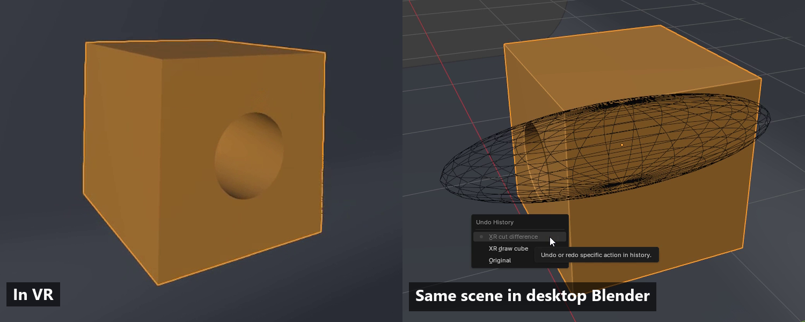
</p>

# Clayspace

**Model, sculpt, shade and animate in real Blender, from inside your VR headset.**

[](LICENSE)
[](#hardware-status)
[](#hardware-status)
[](#hardware-status)
[](#install-in-3-steps)

### [Download Clayspace for Windows](https://github.com/CurioCrafter/Clayspace/releases/latest)

You put the headset on and Blender is there with you. Point at something, pull the
trigger and hold. A preview shows what you are about to make, and letting go commits
it as one normal Blender undo step. Everything you touch is ordinary Blender data:
meshes, modifiers, node trees, keyframes. Take the headset off and the scene is
already open on your desktop, with your VR edits in the undo history. There is
nothing to export.

Clayspace is free and open source (GPL). It is a patch to Blender plus an
add-on, and it runs in its own profile, so your normal Blender settings and add-ons
are left alone.

> The pictures on this page were captured in a desktop OpenXR simulator with
> scripted input, so no real hands or controllers are visible (the props in hand are posed by script). See
> [Hardware status](#hardware-status) for what has been checked on a real headset.

## Install in 3 steps

1. **Download** the zip for one Blender version from the
   [latest release](https://github.com/CurioCrafter/Clayspace/releases/latest).
   If you are not sure, take **5.1.2**: it is the version Clayspace is developed and
   tested on. Each zip is a complete portable Blender with Clayspace already installed.
   `SHA256SUMS.txt` on the release page lets you check the download.
2. **Extract** it to a folder you own, for example `D:\Clayspace` (not
   `Program Files`). It needs about 0.7 to 0.9 GB.
3. **Start SteamVR** and double-click the launcher for your headset:

   | Headset | Before you start | Double-click |
   | --- | --- | --- |
   | **Valve Index** | SteamVR Room Setup done, Direct Display Mode on | `Start Clayspace (Valve Index).cmd` |
   | **Meta Quest 3** (PC VR) | Connected with Quest Link, Air Link or Steam Link so SteamVR sees it | `Start Clayspace (Quest 3).cmd` |

The first time, a short Guide opens on your hand. After that, VR starts with the hand
menu open and the desktop hidden. Small labels next to each controller always show
what every button does right now.

Windows may warn that the launcher comes from an unknown publisher; the files are not
code-signed. The launcher is a short PowerShell script in the `launcher` folder, and
you are welcome to read it first. Logs go to `profile\logs`.

Already built Blender yourself? `Clayspace-0.20.0-addon.zip` is the add-on alone
(Edit > Preferences > Get Extensions > Install from Disk). It needs a Blender built
with the Clayspace patch, see [Build from source](#build-from-source-windows), and it
will tell you so if the patch is missing.

## New in 0.20: 3D tools you hold

Every tool now has a small 3D prop in your hand, and its working tip is the spot you
point at. A loop tool for Clay, a trowel for Flatten, a bulb for Inflate, a hook for Snake Hook, a helix for the
Subdivision Lab, a lattice glove for Live Cage. They also turn slowly in the tool
wheel, so you can tell what you picked without reading.

<p align="center">
  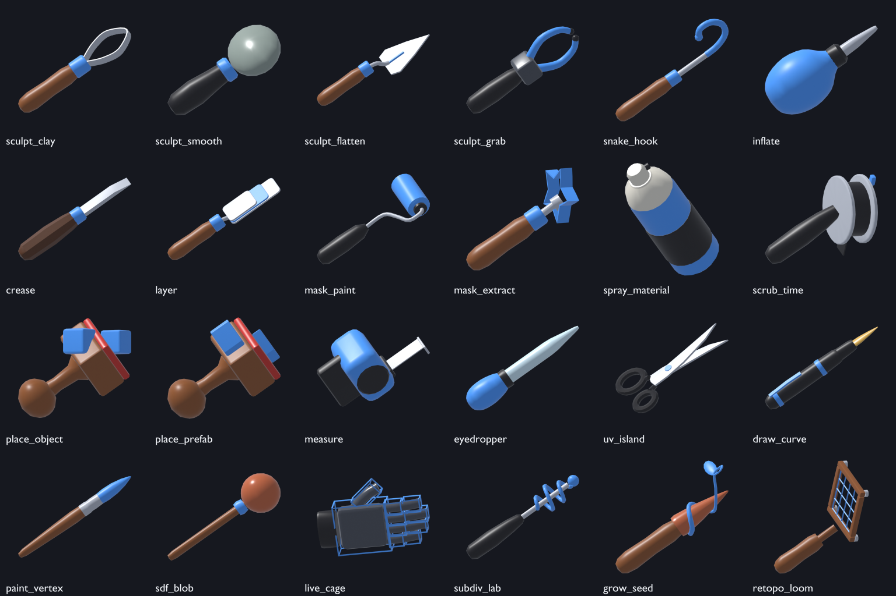
</p>

<table>
<tr>
<td width="50%">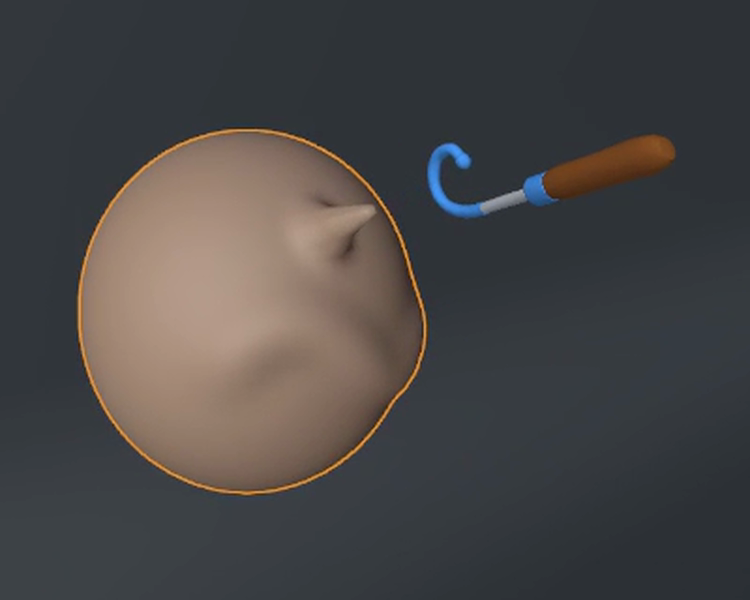<br>
<b>Props in hand.</b> The Snake Hook pulling a spike out of a ball of clay. Turn the props off
in Settings &gt; Tools.</td>
<td width="50%">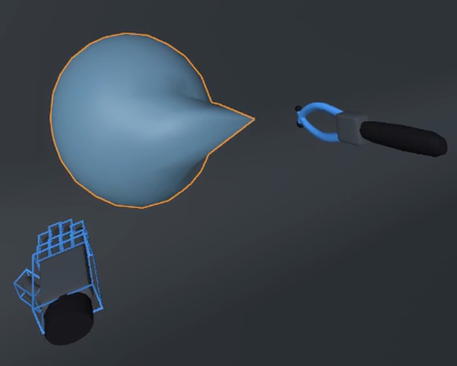<br>
<b>Live Cage.</b> While you grab or sculpt an object with heavy modifiers, you work on its
plain base mesh so it stays fast. Let go and the full subdivision, Boolean or Geometry
Nodes result comes back. The modifier stack and every undo step always keep the real
settings. Set it per object to Auto, On or Off.</td>
</tr>
<tr>
<td>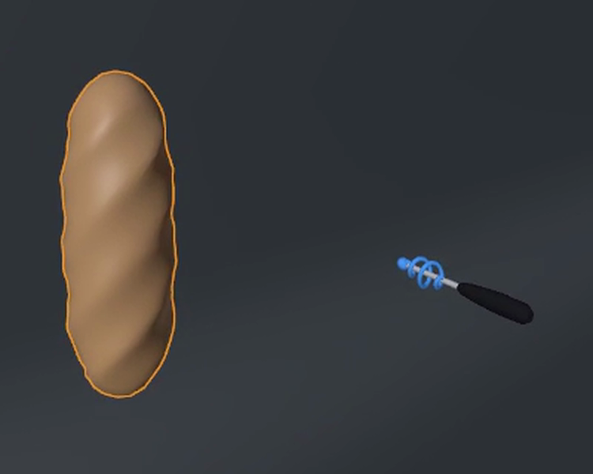<br>
<b>Subdivision Lab.</b> Twist Spiral, Hard Surface, Organic, Greeble and Triangle Smooth,
each one a Geometry Nodes group made for you and added as a normal modifier. Raise your
hand for Levels, roll your wrist for the scheme's main value, then release for one undo
step. Bake turns it into real geometry.</td>
<td>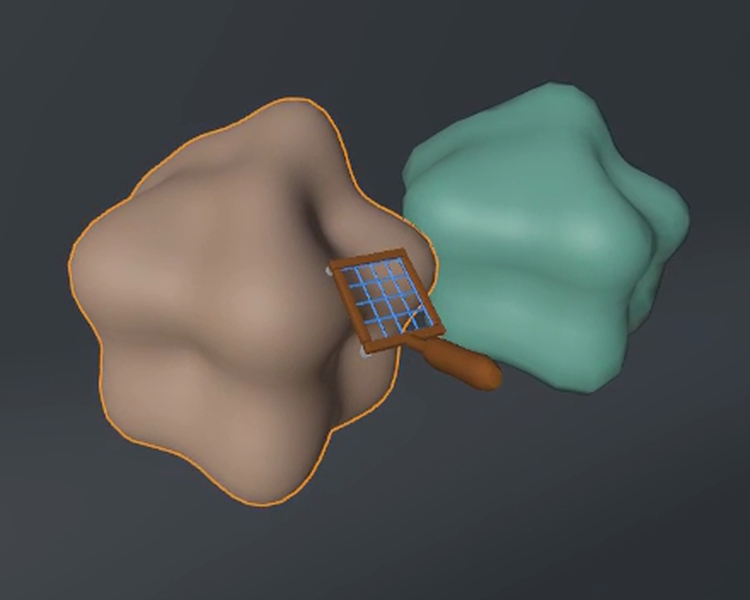<br>
<b>Retopo Loom (CurioMesh built in).</b> Point at a mesh and pull the trigger: it makes a
clean all-quad copy at the face count you choose (Fast, Balanced or Best) and leaves
your original untouched. The solve is synchronous: about 15 seconds on the 2,048-face
scan shown here, and the view waits while it runs.</td>
</tr>
</table>

Also new in 0.20:

- **Sculpt pack:** Snake Hook, Inflate, Crease and Layer brushes, plus Mask paint and
  Mask Extract. Twin Hands: pull the other trigger on the surface and a second brush
  joins the stroke, still one undo step.
- **Brush Dial:** hold the off-hand trigger in the air with a sculpt tool. Raise your
  hand to double the brush size every 10 cm, roll your wrist for strength. With Retopo
  it sets the target face count in steps of 500.
- **Guided Growth:** plant a Branch, Vine or Spiral seed, pull to set direction and
  length, roll the wrist to curl, right A to re-roll. It makes a real, editable curve
  with a skin modifier.
- **Folding hand menu:** each page is cut into sections you can fold, with a summary
  line when folded. Pin up to two to the top of every page, or switch on Compact mode.
  What is open stays open next time.
- **Tool Belt (off by default):** your first six tools float below your eyes; squeeze a
  grip near one to switch.

## What you can do

<table>
<tr>
<td width="50%">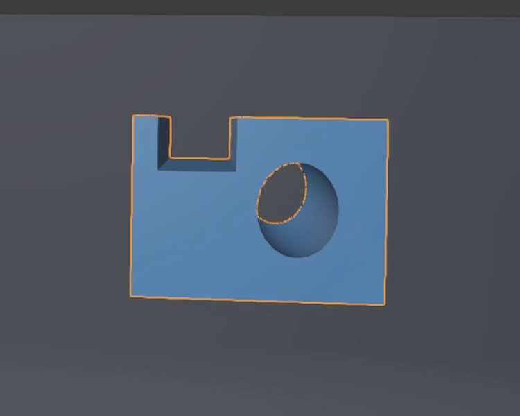<br>
<b>Live Booleans.</b> Draw a cutter and watch it cut, join or keep the overlap while you
move it. It stays a real Boolean modifier until you apply it.</td>
<td width="50%">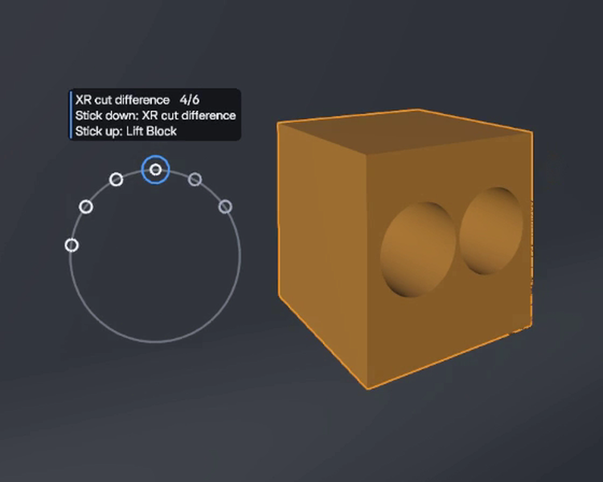<br>
<b>Undo Ring.</b> Blender's own undo history around your hand, every step by name.
Scrub back and forward with the stick; each notch is a real undo or redo.</td>
</tr>
<tr>
<td>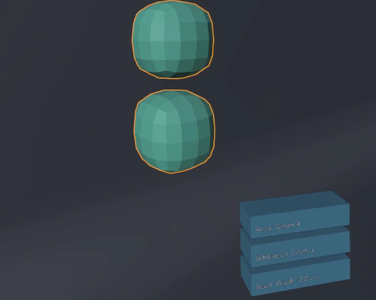<br>
<b>Modifier Tower.</b> The modifier stack as blocks you can hold. Move a block up or down
to reorder, trigger it to switch it on or off, push the stick to dial its main value.</td>
<td>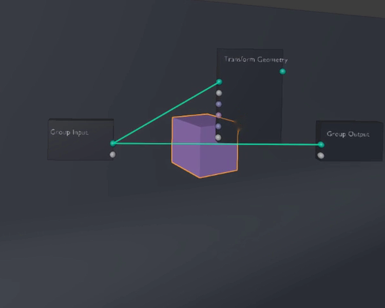<br>
<b>Node Garden.</b> A material or Geometry Nodes tree as blocks standing in front of you.
Drag from socket to socket to link, and the object updates live. The node editor stays in step.</td>
</tr>
<tr>
<td>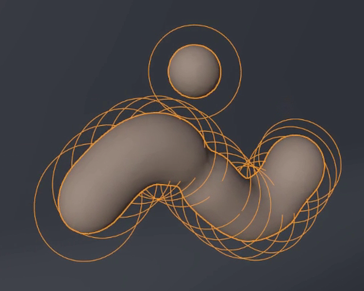<br>
<b>SDF blobs.</b> Draw trails of clay that melt together, carve them away smoothly, then
bake the result to a mesh. The ring at the pen tip is exactly the size you get.</td>
<td>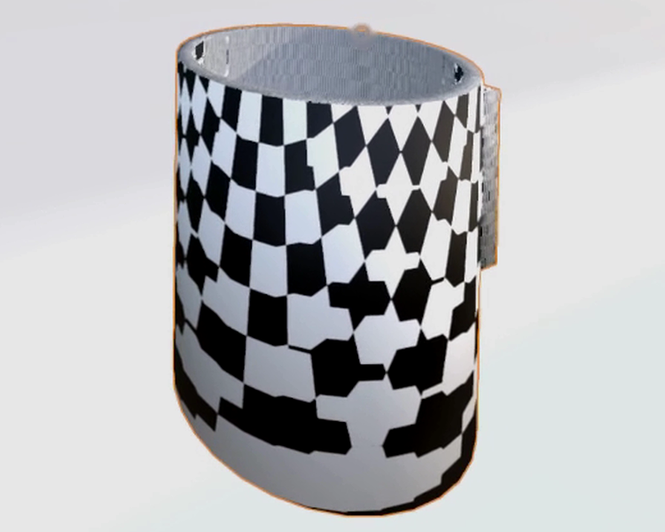<br>
<b>UVs by parts.</b> Point at a face and a UV island floods out to a crease angle you
choose. Let go and just that part is unwrapped, with its border as seams.</td>
</tr>
<tr>
<td>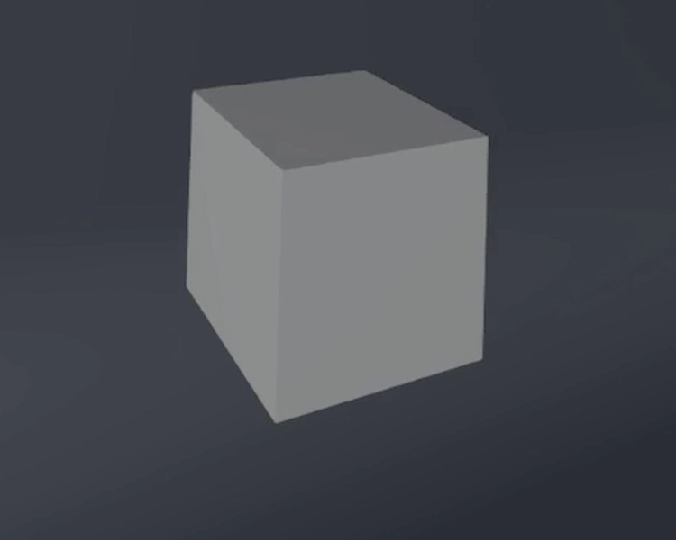<br>
<b>Draw shapes.</b> Draw boxes, spheres and cylinders by hand at the size you want, or
place one with a ghost preview. Letting go commits it as one undo step.</td>
<td>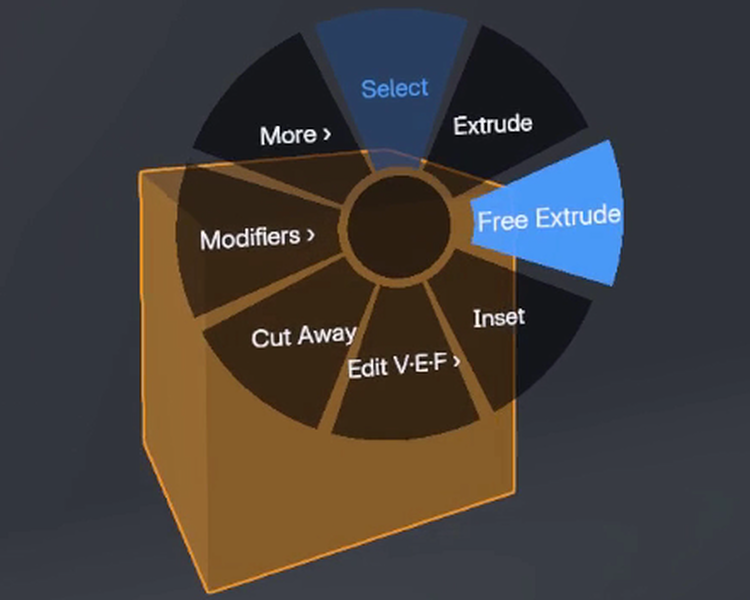<br>
<b>Tool wheel.</b> Click the right stick, move your hand a few centimetres toward a tool
(you feel a tick for each one) and click again.</td>
</tr>
<tr>
<td colspan="2">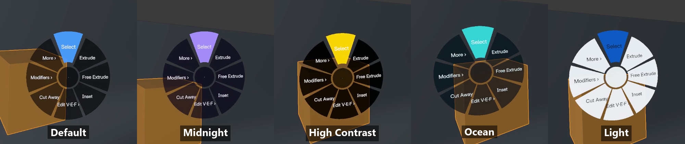<br>
<b>Five themes.</b> Default, Midnight, High Contrast, Ocean and Light, switched live from
Settings &gt; Feel. Plate labels are chosen to stay readable over dark and bright scenes.</td>
</tr>
</table>

And the rest of the toolbox:

- **Model:** place shapes with a ghost preview or draw boxes, spheres and cylinders by
  hand. Extrude faces straight or freely, chain extrusions, inset, bevel, Multi-Select,
  Tape Measure, Arrange. Vertex, Edge and Face editing with ray picking.
- **Hold and shape:** carry objects with the grip, stretch with both hands, switch
  between Precision, Snap and Surface modes, stamp copies.
- **Sculpt:** Clay Ball, then Grab, Clay, Dig, Smooth and Flatten, with trigger pressure
  and Mirror X. Shrink yourself and the brush gets finer.
- **Shade and paint:** material blocks you can hold, spray paint, an eyedropper, saved
  presets, Paint Colour and a 3D Pen that draws tubes in the air.
- **Animate:** key, delete key, jump between keys, play, record with auto-key, and scrub
  time with your hand.
- **Stage:** lights at your hand, a camera where your eyes are, Live Render in the
  headset, world presets and physics.
- **Studio:** modifiers, lights, camera and render, world, physics, rigging and a scene
  outline, all in hand menus.
- **Prefabs:** 34 real-size starters (furniture, architecture, nature, props,
  characters), three starter scenes, and Save Selection as Prefab for your own.
- **All of Blender:** walk the File, Edit, Add and Object menus with the stick, and open
  any Blender editor on a floating desktop panel. The
  [Blender coverage map](docs/blender-coverage.md) shows how each area is reached.

## How it feels

While you work, a small plate by your hand shows what is happening in real units, like
"Extrude 12.4 cm" or "Moved 23 cm · 15°". You feel a soft tick at every centimetre,
every 15° and every snap cell. A finished action is a crisp double tap and a refused one
is a low buzz, so you can tell them apart without looking. Results float by the hand that
made them for a moment, with a green, amber or red edge.

You can make it yours from Settings in VR: put any action on any button, switch to
left-handed, tune trigger and grip sensitivity (a lighter grip helps on Quest 3), pick
which tools the wheel shows, set snap sizes, travel speed, snap turn and vignette, or
pick the Gentle, Balanced or Pro comfort preset in one tap. Settings are saved in the VR
profile's `xr_workbench/vr_prefs.json`.

## Controls at a glance (defaults, right-handed)

| | Index | Quest 3 |
| --- | --- | --- |
| Use a tool / press a button | Either trigger (harder squeeze = stronger clay, wider spray) | Either trigger |
| Pick up what you point at (moves and turns with your hand) | Right grip | Right grip |
| Resize / turn with both hands | **Squeeze the other grip on it too** (or its trigger) and pull apart | Same |
| Hand menu (sits on your **left** hand; point and click with the right) | Right A | Right A |
| Add shapes, **prefabs** and **SDF blobs** | Right B | **Right B** (now the same as Index) |
| **Tool wheel** (flick toward a tool, click again) | Right stick click | Right stick click |
| Undo | Left A | X |
| Back / cancel / hide desktop | Left B | Y |
| Show / hide the Blender desktop | Left stick click | Left stick click |
| Walk / turn | Left stick / right stick | Left stick / right stick |
| Grab the world | **Either grip on empty space**; **both grips: pull apart / together to change your size, twist to turn** (clicks at 1x) | Same |
| Teleport | Left pad, or Settings > Start & Travel > **Teleport** (left stick forward, aim, let go) | **Teleport mode** (left stick) |
| Vertex / Edge / Face | Wheel, Edit page, or Quick > Edit V·E·F; trigger picks, sweep adds, grip moves | Same |
| Move floating panels | **Squeeze a grip while pointing at one** (Index right pad also works) | Squeeze a grip on one |

**Brush Dial:** with a sculpt tool, hold the off-hand trigger in the air, raise your hand
for a bigger brush and roll your wrist for strength. B cancels. **While you hold something:** right A stamps a copy, right stick click cycles
Follow / Precision / Snap / Surface, right stick up/down pushes or pulls it, left
stick click sets it down on the surface below. **While you extrude:** right A keeps
the segment and extrudes again from its new end; right stick click switches between
straight out and free. **In a menu:** right stick up/down picks, stick click presses,
B goes back. **Undo Ring:** right stick down steps back, up steps forward, any button or
B closes it. The full map is in [docs/controller-map.md](docs/controller-map.md).

## Hardware status

Honest version: almost everything in 0.20 has been tested in real Blender with
simulated input, and not yet by someone wearing a headset. The new props, wheel icons,
Tool Belt, falloff rings and cage wire are drawn on the GPU, and no automated check can
see that, so they have only been seen in the desktop simulator.

| What | Status |
| --- | --- |
| Tools, undo, menus, settings (Blender 5.1.2) | The automated checks in real Blender pass for 0.20, with simulated controller input: geometry, exact cancel, one-step undo, rendered hand-menu pages, menu navigation through Blender's event simulator, Index/Quest/Auto controller profiles with no input bound twice |
| Blender 4.5.15 LTS, 5.0.1, 5.2.3 LTS | Built from the official tags with the matching patch. The 0.20 checks have been run on 4.5.15 (not yet on 5.0.1 and 5.2.3); the 0.19 checks passed on all three. Never run in a headset. Hand tracking stays off on 4.5 and 5.0 (their OpenXR SDK lacks it), and 4.5 has no snap-turn or vignette option |
| Valve Index | Earlier builds ran in a real Index through SteamVR with scripted input, and a 5.1.2 test build showed its scene and a floating card in the headset. The 0.20 controls and feel have not been confirmed on an Index yet |
| Meta Quest 3 through Link / Air Link / Steam Link | Controller bindings checked with simulated input only. Not yet confirmed on a headset |
| Standalone Quest, Linux, macOS | Not supported |
| Desktop OpenXR simulator (no headset) | Used for the recordings on this page (captured with scripted input, no hands visible); see [docs/steamvr-free-runtime.md](docs/steamvr-free-runtime.md) |

Nothing is called hardware-verified until someone wearing the headset confirms it. If
you try it, an issue saying what worked and what didn't helps a lot. Evidence and open
questions: [controller map](docs/controller-map.md) ·
[physical workflows](docs/physical-workflows.md) ·
[native interaction validation](docs/native-interaction-validation.md).

## How it compares

There are good VR creation tools already, and they make different trade-offs:

| | Works on | Data | Price |
| --- | --- | --- | --- |
| **Clayspace** | A patched Blender (the release zip includes it), PC VR on Windows | Blender's own scene, modifiers, node trees and undo | Free, GPL-3.0-or-later |
| Blender's VR Scene Inspection | Any Blender, built in | Blender's own scene; made for viewing and walking around | Free, part of Blender |
| Freebird XR | Regular Blender as an add-on, with a quick setup | Blender's own scene | From $15 (pay what you want), free for students |
| Gravity Sketch, Substance 3D Modeler, Shapelab | Their own apps, several also standalone on Quest | Their own files; export to bring work into Blender | Free to paid, depending on the app |

If you want something that installs into the Blender you already have, Freebird is the
easier start. If you want to work on Quest without a PC, a standalone app will suit you
better. Clayspace is for when you want Blender's full toolset in the headset and the
result already in your .blend.

## Build from source (Windows)

Install Visual Studio 2022 C++ tools and Windows SDK, CMake, Ninja, Git, Git LFS,
and Python. Put the command-line tools on PATH. The GitHub repository publishes
our source and a consolidated patch, not personal add-ons or Blender binaries.
From a fresh clone:

```powershell
git clone https://github.com/CurioCrafter/Clayspace.git
Set-Location Clayspace
git lfs install
git clone https://projects.blender.org/blender/blender.git native/blender-5.1.2
git -C native/blender-5.1.2 checkout --detach ec6e62d40fa9e9d1bea33ad5d00148c99a4f0832
git -C native/blender-5.1.2 apply --check ../patches/blender-5.1.2-xr-workbench.patch
git -C native/blender-5.1.2 apply ../patches/blender-5.1.2-xr-workbench.patch
git clone https://projects.blender.org/blender/lib-windows_x64.git native/dependencies/windows_x64_5_1
git -C native/dependencies/windows_x64_5_1 checkout --detach 17e87e0869383bcf1dd8339502e6008b7c0c8eb0
git -C native/dependencies/windows_x64_5_1 lfs pull
powershell -NoProfile -ExecutionPolicy Bypass -File native/build_feature_complete.ps1 -Target install -Jobs 4
powershell -NoProfile -ExecutionPolicy Bypass -File scripts/launch_steamvr_blender.ps1 -Launch -CleanProfile
```

Output: `native/build-features/bin/blender.exe`, with runtime resources beside it.
The install stays within the checkout. Dependencies and compilation require
substantial disk space; vendor-specific Cycles GPU kernel bundles are not built.
Use `-ControllerProfile QUEST` on the clean launcher for Quest-only bindings.
See [detailed build instructions and checks](native/README-source.md) for toolchain
overrides, patch verification and optional research dependencies. The recipe's
patch application/content parity is tested; a fresh-machine full build is not.

Other Blender versions have their own patch in `native/patches`. Check out the
tag, apply its patch, and use the official `lib-windows_x64` commit that the tag's
`lib/windows_x64` submodule names. Configure the build the same way as the script, but point it at
that source and library folder:

| Blender | Tag | Patch | lib-windows_x64 commit |
| --- | --- | --- | --- |
| 4.5.15 LTS | `v4.5.15` | `blender-4.5.15-xr-workbench.patch` | `d682199c7ee7daf687fb2228828e6750096522de` |
| 5.0.1 | `v5.0.1` | `blender-5.0.1-xr-workbench.patch` | `854341cfd7e21b2cc45c7f8edbf19543cb51519c` |
| 5.2.3 LTS | `v5.2.3` | `blender-5.2.3-xr-workbench.patch` | `60d6e96b917568278d400a4024c98da0fb777338` |

Blender 4.5 and 5.0 ship OpenXR SDK 1.0.22, which has no hand-tracking data-source
extension, so native hand tracking stays inactive on those two builds. Blender 4.5
also has no XR snap-turn or vignette preferences. The add-on accepts Blender 4.5.0
up to 5.3.0, but it refuses to register on a Blender build that lacks the Clayspace patch.

Developer checks:

```powershell
python -m unittest discover -s tests
& native\build-features\bin\blender.exe --background --factory-startup --python scripts\xr_workbench_smoke.py
```

The other `scripts\xr_*_smoke.py` files run the same way.

## Version history (short)

- **0.20:** a 3D prop for every tool, Live Cage (fast base mesh while you edit modifier-heavy
  objects), Subdivision Lab (five Geometry Nodes schemes, dialled by hand), Retopo Loom
  (CurioMesh built in), Snake Hook / Inflate / Crease / Layer / Mask sculpting, Twin Hands,
  Brush Dial and falloff rings, Guided Growth, a folding hand menu and the Tool Belt.
- **0.19:** Undo Ring (scrub the real undo history), Modifier Tower (the modifier stack as
  blocks you reorder, switch and dial), Geometry Nodes trees in the Node Garden, five colour
  themes, portable builds for Blender 4.5.15, 5.0.1, 5.1.2 and 5.2.3.
- **0.18:** movement: grab the world with either grip, two-hand world turn and resize with a 1x
  click, Smooth / Teleport / Fly locomotion (stick teleport for Quest), Go to Selection, Reset View.
- **0.17:** controls unified for Quest 3 and Index (menus on the off hand, Quest B = Add, grip
  a panel to move it); 34 prefabs, starter scenes and your own prefabs; SDF blob modeling.
- **0.16:** stick click always presses in open menus; hover follows the hand pointing at the
  menu, with a cursor dot and row ticks; both grips resize a held object (soft dead zones,
  Two Hands setting); the face you extrude is filled and outlined live; Vertex / Edge / Face
  editing with ray picking, sweep selection, Extrude Selection and mesh actions.
- **0.15:** Studio (modifiers, lights, camera, render, world, physics, rigging, outline),
  Stage workflow and wheel, 3D Pen, Paint Colour, Blender coverage map.
- **0.14:** live readouts, detents, toasts, haptic double taps, hover outlines, rounded
  unified overlay, animated wheel, Gentle / Balanced / Pro presets.
- **0.13:** tool wheel, Node Garden, UV islands, free and chained extrusion, inset,
  Tools settings (snap, precision, wheel, labels).
- **0.12:** assignable buttons, left-handed mode, sensitivity, Quest 3 guidance,
  Flatten brush, Eyedropper.
- **0.11:** button labels, Blender Menus with Back, menu at start, upright drawing,
  per-axis stretch, double-ray fix.
- **0.10:** Multi-Select, Surface hold mode, Tape Measure, Arrange.
- **0.9:** ghost previews, solid draw previews, Add menu, stick-driven menus.
- **0.8:** stamp copies, Precision/Snap, set-down, Quick menu, trigger pressure,
  Mirror X.
- **0.7:** sculpt, material blocks and spray, animation, workflows, change your size,
  grip grab, two-hand stretch, haptics, ray rings, Guide.
- **0.6:** native XR dispatch fixes, hand menus, draw/Boolean/bevel tools, logging.

The 0.6 engineering notes, the camera and hand-tracking research launchers and the older
4.5.11 VR Workbench add-on are described in [docs/legacy-workbench.md](docs/legacy-workbench.md).

## Safety notes

- VR launches keep the headset cameras **off**. Stay inside your SteamVR boundary.
- The release zips contain Blender builds made from the public source and patch listed in
  each zip's `SOURCE.txt`. They are not code-signed; compare the download with
  `SHA256SUMS.txt` on the release page before running it.
- The camera and hand-tracking launchers in this repository (`Open Index Cameras Live.cmd`,
  `Open Index Headset Hands.cmd`, `Open Index Hand Preview.cmd`) are experiments: they
  show live camera images on your own PC and record nothing, but they are uncalibrated,
  so stay seated.
- A few research probes change SteamVR settings (camera access, keep-awake) only when
  you pass their `--consented-*` / `-ConsentedStream` flags, and put the keep-awake
  values back when they exit.
- The Mercury hand-tracking research uses Monado's hand-tracking models, which have no
  stated redistribution licence. They are not included here and must be fetched by you.
- The `.cmd` launchers run PowerShell scripts with `-ExecutionPolicy Bypass`. Read them
  first if you are unsure.

## License

Copyright (C) 2026 Andrew Rainsberger.

Clayspace is free software: you can redistribute it and/or modify it under the terms
of the [GNU General Public License version 3](LICENSE) or (at your option) any later
version. It comes with no warranty.

The Retopo Loom uses CurioMesh, copyright (c) 2025 CurioCrafter, which is under the MIT
license. An unmodified copy with its license text is in `xr_workbench/curiomesh/`.
MIT is compatible with the GPL, and the notice stays with the code.

The Blender patch in `native/patches/` changes Blender's own GPL-2.0-or-later source
and keeps the Blender Authors' notices. A few native probes are under the Boost
Software License 1.0, which is compatible with the GPL. Third-party dependencies
(Blender, OpenXR, OpenVR, Monado, OpenCV, ONNX Runtime) are fetched at build time
under their own licences and are not included in this repository. The release zips
include a Blender build; each one's `SOURCE.txt` names the exact upstream commit, patch
and library commit, and the full source is this repository.

Clayspace is an independent community project. It is not made, endorsed or supported
by the Blender Foundation. Blender is a trademark of the Blender Foundation; Valve
Index, SteamVR and Meta Quest are trademarks of their owners.
